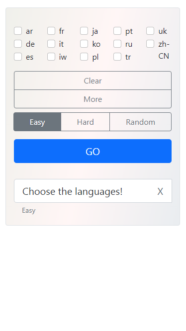
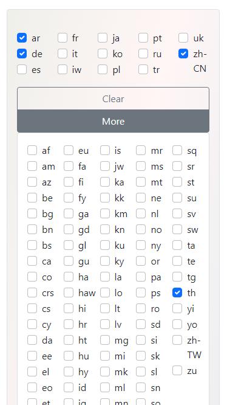
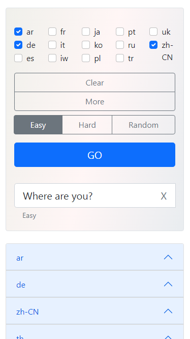
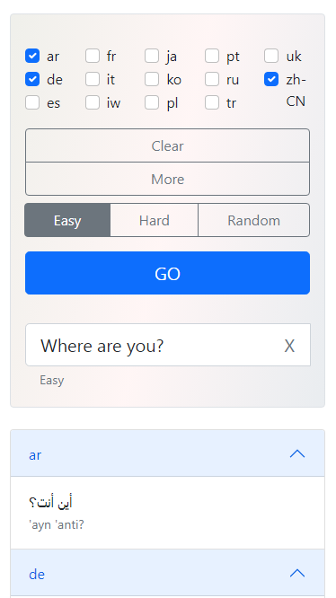
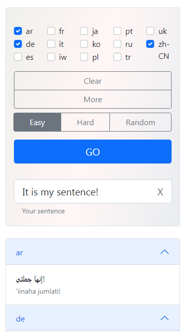

# Multiple Translator


*2022: original git history*

A simple app for learning languages by translating the same sentence into multiple languages at once.

> Set up over time on the free tiers of PythonAnywhere, Heroku and Vercel; none of the deployments is live any more.

> [!NOTE]
> **No longer working correctly.** The app worked originally, but today translations come back as the original English sentence. It relies on the unofficial `googletrans` library. In tests in November 2026, Google answered googletrans 4.0.2 with HTTP 429 (Too Many Requests) on two different networks, and the pinned 3.1.0a0 shows the same symptom. To make it work again, replace the translation call in `MultipleTranslator` (`translator.py`), the only place that uses `googletrans`, with another translation provider, for example the official Google Cloud Translation API (needs a Google Cloud project, credentials and billing).

## How it works

1. Choose the languages (up to 9)
2. Write a sentence or generate one by clicking "GO"
3. Before unfolding each translation, try to translate the sentence in your mind
4. Unfold all translations, then repeat from step 2

## Demo

Fully responsive — works the same on desktop and mobile.

| Start | More languages | Generated, folded | Unfolded | Next sentence |
|---|---|---|---|---|
| [](screenshots/mobile/start.png) | [](screenshots/mobile/more-languages.png) | [](screenshots/mobile/generated-folded.png) | [](screenshots/mobile/generated-unfolded.png) | [](screenshots/mobile/your-sentence.png) |

## Structure

```
translator.py        Flask app with sentence drawing and translation
requirements.txt     Pinned dependencies
templates/           HTML page (Jinja template)
static/              Stylesheet (css/styles.css)
sentences_base.txt   Easy sentences from the sites listed in Credits
GenericsKB-Best.tsv  Hard sentences from GenericsKB, about 90 MB
screenshots/         Screenshots (desktop/, mobile/)
.vscode/             Editor setting: autopep8 formatter
.gitattributes       Git line-ending setting
```

## Install

Requires Python 3.6.

```bash
git clone https://github.com/nieczuje/multiple-translator.git
cd multiple-translator
python -m venv venv
venv\Scripts\activate          # Windows
source venv/bin/activate       # macOS / Linux
pip install -r requirements.txt
```

## Usage

```bash
python translator.py
```

Then open `http://127.0.0.1:5000` in a browser. Run it from the repo folder, because `sentences_base.txt` and `GenericsKB-Best.tsv` are read by relative path.

## Tech

Python, Flask, some JavaScript, Bootstrap. Translations via the googletrans Google Translate Ajax API.

## Credits

- Sentence data: [GenericsKB](https://huggingface.co/datasets/community-datasets/generics_kb), Allen Institute for AI — [CC BY 4.0](https://creativecommons.org/licenses/by/4.0/). The original page `https://huggingface.co/datasets/generics_kb` no longer works; this is its new address. It covers several subsets, and this project uses GenericsKB-Best. Citation: Bhakthavatsalam, S., Anastasiades, C., & Clark, P. (2020). *GenericsKB: A Knowledge Base of Generic Statements*.
- Example sentences also drawn from [englishstudyhere.com](https://englishstudyhere.com/sentences/1000-sentences-examples-in-english/), [7esl.com](https://7esl.com/english-verbs/), [englishspeak.com](http://www.englishspeak.com/) (the original page `https://www.englishspeak.com/en/english-phrases?category_key=20` no longer works, so this links to the home page), and [onlymyenglish.com](https://onlymyenglish.com/1000-english-sentences-used-in-daily-life/).
- Libraries loaded from a CDN: [Bootstrap](https://getbootstrap.com/), [jQuery](https://jquery.com/) and [Popper](https://popper.js.org/), all MIT License.

## License

MIT License — see [LICENSE](LICENSE).

<div align="right">

*README written with AI assistance.*

</div>
